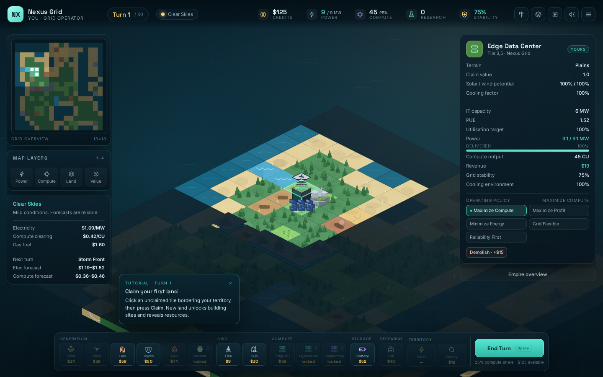
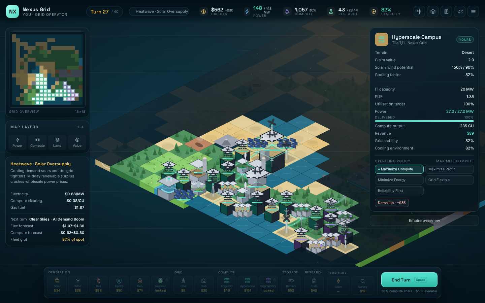
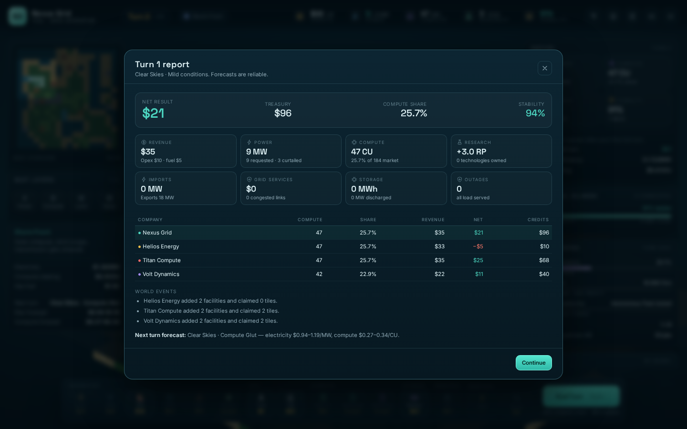
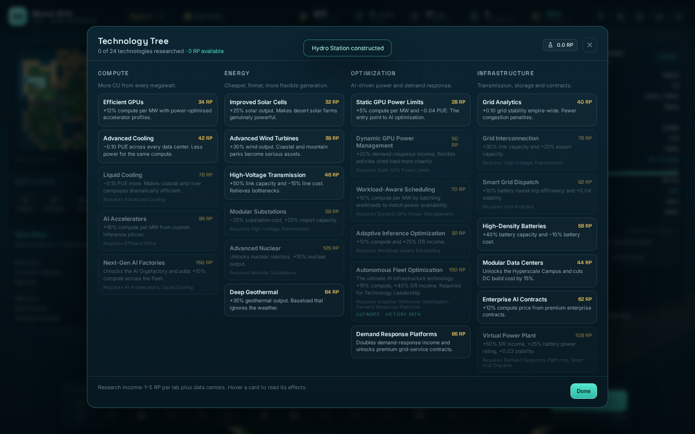

# GRIDPOWER

**Build the grid. Control the compute. Dominate the future.**

GRIDPOWER is a complete single-player, turn-based 4X strategy game about the physical and economic race to build AI infrastructure. You run one of four AI-infrastructure companies on a procedurally generated island: claim land, build generation, string transmission, construct data centers, research balance-shifting technology, and sell compute before your rivals do.

It is inspired by the clarity and pace of *The Battle of Polytopia* and classic turn-based 4X, with an original energy-system theme and simulation.



---

## Quick start

Requirements: **Node.js 20+** and npm. No backend, account, paid API or network access is required at runtime.

```bash
npm install
npm run dev          # http://127.0.0.1:5174
```

Production build:

```bash
npm run build        # typecheck + Vite production bundle in dist/
npm run preview      # http://127.0.0.1:4173
```

Tests and simulations:

```bash
npm test             # 37 Vitest engine tests
npm run sim -- 20 100   # 20 complete all-AI matches starting at seed 100
npm run e2e          # Playwright browser test (dev server must be running)
npm run screenshots  # recapture the screenshots in screenshots/ (dev server running)
```

`npm run dev` is pinned to port **5174** so it does not collide with other local projects. If you change the port, pass `BASE_URL=http://127.0.0.1:<port>` to `e2e`/`screenshots`.

---

## What is in the game

### A real map, not a menu of sliders

An 18×18 (configurable 13/18/24) seeded island with plains, desert, mountains, forest, rivers, coastline, geothermal fields, gas basins and urban districts. Fog covers unsurveyed tiles; claims and survey drones reveal it. Every start is stamped with a viable pocket: a data center, a substation, a generator and buildable expansion land.



### Electricity is a flow, not a currency

* Six generation technologies with distinct economics: solar, wind, gas, hydro, geothermal and nuclear.
* A max-flow power solver connects adjacent structures. Link capacity is the smaller structure's rating, so a 30 MW line cannot feed a 74 MW gigafactory — put a substation on that campus.
* Electrical islands, congestion, curtailment, imports and exports are all modelled and visualised in the power overlay.
* Batteries charge from surplus and discharge into deficits, with real round-trip efficiency and state-of-charge conservation.
* Weather (heatwave, cold snap, storm, wind drought, dust storm) changes renewable output and cooling load; market events (AI boom, solar oversupply, grid emergency, fuel spike, compute glut) move prices.

### Compute is the scoreboard

Data centers convert delivered IT power into compute using PUE, accelerator efficiency, utilisation and technology. Three tiers (Edge DC → Hyperscale Campus → AI Gigafactory) and five operating policies create real trade-offs. Compute is sold at a market clearing price that falls as the fleet-wide supply grows.

### Four X pillars

* **Explore** — fog, survey drones, resource discovery, neutral substations.
* **Expand** — territory claims with escalating cost, grid corridors, new campuses.
* **Exploit** — merit-order dispatch, storage arbitrage, efficiency research, demand response.
* **Exterminate/Compete** — rival expansion, contested neutral infrastructure, market share and contract economics. No military units; victory is economic and infrastructural.

### Three rivals, three strategies

* **Helios Energy** — renewable build-out, cheap power, rapid land grab.
* **Titan Compute** — hyperscale campuses and compute-market share, aggressive spending.
* **Volt Dynamics** — storage, substations, demand response and reliability.

They use persona-weighted utility scoring over legal actions, with forecast-aware renewable choices, reserve planning on nameplate capacity, and victory-relevant tech preferences. AI turns resolve in milliseconds and are deterministic.

### Ways to win

1. **Compute Dominance** — ≥60% of the compute market for 3 consecutive turns (from turn 18).
2. **Energy Empire** — 130 MW firm generation, 6 grid links, $260 treasury and $45 net profit for 2 turns.
3. **Technology Leadership** — Autonomous Fleet Optimization plus 14 CU per delivered MW for 2 turns.
4. **Score at turn 40** — revenue, technology, territory, compute share and treasury.

A company can also be wound up after two insolvent turns; its assets are abandoned.

### Presentation

* Custom isometric Canvas 2D renderer (no external art assets): stylised land, cliffs on coastlines, animated wind turbines, spinning cooling fans, solar shimmer, battery charge bars, blinking server racks, steam, glowing power lines with moving energy particles.
* Power / Compute / Land / Value overlays, minimap, contextual tile inspector, empire dashboard, victory progress, event log, tech tree, turn summary, tutorial hints, pause and game-over screens.
* Procedural Web Audio sound effects and an ambient pad, with a persistent mute toggle.
* Keyboard shortcuts and full mouse/trackpad pan/zoom.

---

## Controls

| Action | Input |
|---|---|
| Pan | drag with left mouse, or arrow keys |
| Zoom | mouse wheel, `+` / `-` |
| Recentre on your empire | `F` |
| Select tile | click |
| Build | pick a structure in the bottom bar, click a highlighted tile |
| Cancel placement | `Esc` or the Cancel button |
| End turn | `Space` or the End Turn button |
| Tech tree / log / help | `T` / `L` / `H` |
| Overlays | `1` Power · `2` Compute · `3` Land · `4` Value · `0` none |
| Pause / close | `Esc` |
| Mute | `M` |

---

## Technology stack and why

* **TypeScript + React 18 + Vite 5** — typed simulation, fast dev loop, tiny production bundle.
* **Zustand** — a single small store for UI intent (selection, modals, audio) that wraps the authoritative engine state.
* **Custom Canvas 2D isometric renderer** rather than Phaser/PixiJS. The game is turn-based: it needs precise drawing of a 300-tile world, deterministic visuals and no asset pipeline. A ~900-line renderer gives complete control over the look, keeps the runtime dependency-free, and produces a 300 KB JS production bundle. All art is generated with vector/canvas primitives.
* **Vitest** for pure engine tests, **Playwright** for browser interaction checks and screenshots.
* **No backend, no external services, no paid APIs.** Saves live in `localStorage`.
* **Assets:** all terrain, buildings, effects and audio are generated procedurally. The only third-party visual assets are the open-font text faces **Inter** and **Space Grotesk** (SIL Open Font License, bundled through Fontsource).

The simulation is fully separated from rendering and UI:

```
src/engine/      deterministic simulation (no DOM, no React, no browser APIs)
src/render/      isometric Canvas renderer and procedural art
src/ui/          React HUD, panels, modals and Zustand store
src/audio/       procedural Web Audio sound board
tests/           Vitest engine suite
sim/headless.ts  all-AI match runner and balance harness
scripts/         Playwright E2E + screenshot capture
```

Read [ARCHITECTURE.md](ARCHITECTURE.md) for the state model, dispatch pipeline and determinism guarantees; [GAME_DESIGN.md](GAME_DESIGN.md) for rules and formulas; [BALANCE.md](BALANCE.md) for parameters and simulation results.

---

## Testing and validation

* **37 engine tests** cover max-flow bottlenecks and islands, dispatch and generation limits, PUE/cooling, battery conservation, imports/exports, territory costs, build legality, research prerequisites and unlocks, policy effects, all four victory paths, insolvency, save/load round-trips and deterministic replay.
* **Headless simulations**: complete all-AI matches run without crashes or invariant failures. 24 matches (seeds 600–623) averaged **38.2 turns** and **60 ms per match**; winners spread across all four companies, with 20 score, 2 energy and 2 compute victories. Stats and tuning notes are in [BALANCE.md](BALANCE.md).
* **Browser E2E**: starts a campaign from the menu, builds, claims territory, ends a turn, checks the summary, opens the tech tree, reloads the page, resumes the autosave and verifies the laptop layout — all through the real UI with zero console errors.
* **Screenshots** in `screenshots/` are captured from the running application by `scripts/screenshots.ts`, including a late-game map resumed from a headless save.




---

## Saving

The game autosaves after every action and at the end of every turn to `localStorage` (`gridpower.save.v3`). The main menu's **Continue campaign** resumes it. The pause menu also offers **Save now** and **Save and return to main menu**. Progress survives page reloads; there is one autosave slot (no cloud, no account).

## Determinism

World generation, weather, market rolls and AI decisions are all driven by one seeded PRNG stored in the game state. The same seed and the same player decisions produce identical worlds and outcomes; this is covered by a test that replays six turns of two independent games and compares the full board and player state.

---

## Known limitations

* AI opponents do not attempt a Technology Leadership victory in headless matches (they usually take score or energy wins); the path is verified by a directed engine test that builds an optimised campus and reaches the condition naturally.
* Once the map is full, late-game treasuries can still accumulate. That surplus is part of the score, but it is less interesting than the mid-game spending decisions.
* The electrical model is a transport max-flow, not AC power flow: voltage, reactive power, frequency and line losses are abstracted away. The documentation states this explicitly.
* Single-player only; one autosave slot; no localization.
* Audio starts after a click (browser autoplay rules) and is procedural, not a licensed soundtrack.

## Documentation

* [GAME_DESIGN.md](GAME_DESIGN.md) — pillars, turn loop, formulas, policies, tech tree, economy.
* [ARCHITECTURE.md](ARCHITECTURE.md) — modules, state, dispatch algorithm, renderer, UI, persistence, tests.
* [BALANCE.md](BALANCE.md) — all tunable values, simulated results, tuning history and open issues.
